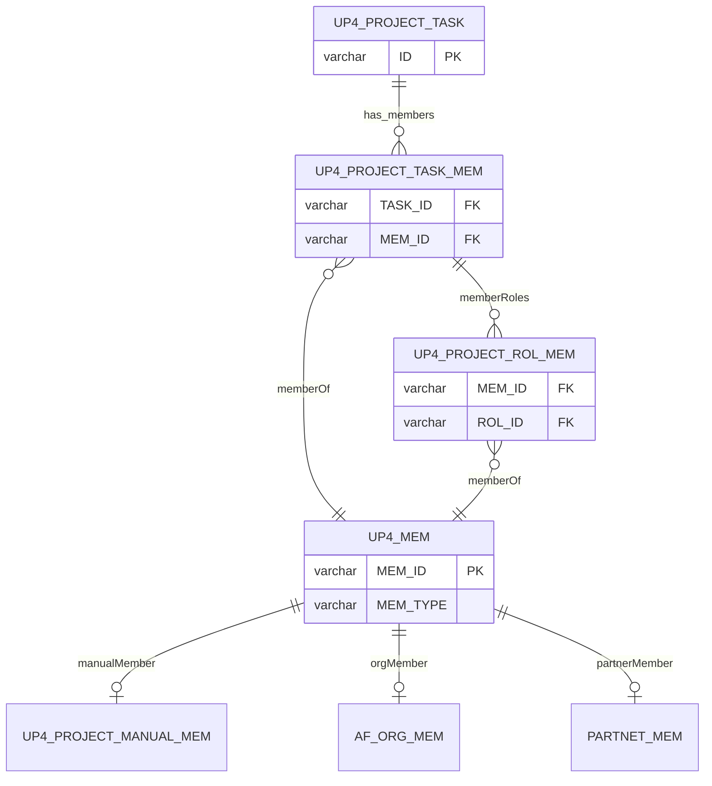
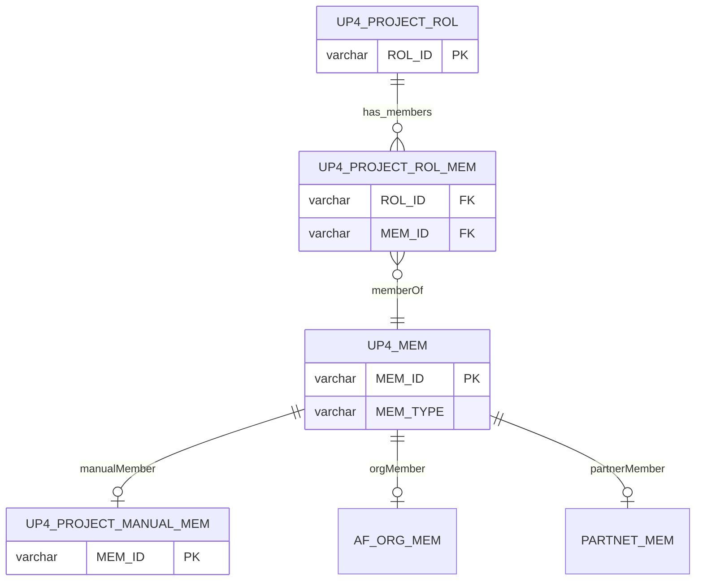

# UP4_PROJECT_MEM 抽表建議

這是個很典型的**「該不該正規化」**的問題,答案是:**大部分情況該抽,但有一個表不該完全依賴它**——這個例外正好是你們已經有的 `MEM_LOG`。我先講為什麼要抽,再講抽了之後哪裡反而要故意保留冗餘。

---

## 1. 現況問題:MEM_TYPE 到處複製會出什麼事

目前 `MEM_TYPE` 散落在 `UP4_PROJECT_ROL_MEM`、以及你 API 回應裡的 `memberList`,只要有 `MEM_ID` 出現的地方就要跟著存一份 `MEM_TYPE`。這種設計違反了資料庫正規化裡最基本的原則:**如果某個欄位的值完全取決於另一個欄位(而不是取決於整筆資料的複合鍵),它就不該被複製存放**。這裡 `MEM_TYPE` 明顯是「這個 `MEM_ID` 是什麼類型的人」,跟他在哪個角色底下、哪一筆關聯資料無關。
有影響的資料
(1) 檔案_UP4_FILE: *記錄當下發生的事，非當前關聯狀態*
(2) 專案職務人員_UP4_PROJECT_ROL_MEM: **關聯狀態**
(3) 里程碑備註_UP4_PROJECT_MILESTONE_NOTE	
(4) 任務備註的留言_UP4_PROJECT_TASK_NOTE_COMMENT	
(5) 任務備註_UP4_PROJECT_TASK_NOTE	
(6) 任務分享資源連結_UP4_PROJECT_TASK_RESOURCE_LINK
(7) 任務分享資源檔案_UP4_PROJECT_TASK_RESOURCE_FILE
(8) 任務交付連結_UP4_PROJECT_TASK_DELIVER_LINK	
(9) 任務交付檔案_UP4_PROJECT_TASK_DELIVER_FILE	
(10) 任務工作日誌_UP4_PROJECT_TASK_WORK_LOG	
(11) 任務成員_UP4_PROJECT_TASK_MEM	
(12) 專案大事記_UP4_PROJECT_EVENT	
同一個  MEM_ID，MEM_TYPE 不可能一樣。

實務上會踩到的坑:

- **資料不一致風險**:同一個 `MEM_ID` 如果在 `ROL_MEM` 表裡有多筆紀錄(例如身兼多個職務),萬一寫入時邏輯沒顧好,可能出現同一個人在不同筆資料裡 `MEM_TYPE` 不一樣——這是典型的「應該不會發生但實際上會發生」的 bug 來源。
- **異動困難**:如果哪天一個企業夥伴(`partner_manual`)轉正變成組織員工(`org`),你要去改**所有**存過這個人 `MEM_TYPE` 的地方,改一個漏一個,系統就會拿錯的來源去查人員資料。
- **語意上,`MEM_TYPE` 的本質是「路由資訊」**:它決定要去哪個資料源查這個人的姓名、頭像等詳細資料(組織系統 / 企業夥伴系統 / 手動輸入的本地資料)。這種「決定去哪裡查資料」的資訊,理論上應該只在一個地方維護一份,其他地方只要拿 `MEM_ID` 去查就好。

---

## 2. 建議:抽出來,但要先確認一個業務問題

抽表方向是對的,但抽之前要先確認**一個關鍵業務規則**,這會決定表的主鍵設計:

> **同一個 `MEM_ID`,在不同專案裡,`MEM_TYPE` 有沒有可能不一樣?**

- 如果**不可能**(一個人的身份類型是全域性的,不會因為換了專案就變成另一種類型) → 主鍵就是 `MEM_ID` 本身,這張表可以是全域共用表,不需要綁 `PROJECT_ID`。
- 如果**有可能**(例如某人平常是組織員工,但被拉進某個特定專案時是以「企業夥伴」身份加入) → 主鍵要是 `(PROJECT_ID, MEM_ID)` 複合鍵,而且表名 `UP4_PROJECT_MEM` 這個命名(帶 `PROJECT`)其實已經暗示是後者的設計意圖。

這個問題務必跟業務端確認清楚,因為這決定了整張表的骨架,事後改主鍵是很痛的遷移。以你目前的命名習慣(`UP4_PROJECT_ROL`、`UP4_PROJECT_ROL_MEM` 都是專案範疇),我猜測傾向**後者**(專案範疇),下面就以複合鍵設計來示範。

## 3. 表設計

```sql
CREATE TABLE UP4_PROJECT_MEM (
    PROJECT_ID   VARCHAR(30)  NOT NULL,  -- 專案 ID
    MEM_ID       VARCHAR(50)  NOT NULL,  -- 人員 ID
    MEM_TYPE     VARCHAR(20)  NOT NULL,  -- org / partner_system / partner_manual
    MEM_NAME     NVARCHAR(255),           -- 見下方說明:是否要快取
    AVATAR       VARCHAR(255),
    CREATED_AT   BIGINT,
    UPDATED_AT   BIGINT,
    PRIMARY KEY (PROJECT_ID, MEM_ID)
);
```

`ROL_MEM` 就可以把 `MEM_TYPE` 拿掉,改成單純的關聯表:

```sql
-- Before
UP4_PROJECT_ROL_MEM (PROJECT_ID, ROL_ID, MEM_ID, MEM_TYPE)

-- After
UP4_PROJECT_ROL_MEM (PROJECT_ID, ROL_ID, MEM_ID)  -- MEM_TYPE 透過 JOIN UP4_PROJECT_MEM 取得
```

**關於 `MEM_NAME`/`AVATAR` 要不要快取在這張表**:這是另一個要決定的取捨。如果姓名頭像永遠即時去源頭系統查(組織系統 API、企業夥伴系統 API),就不需要存在這裡,直接查就好,資料永遠是最新的,但每次都要打外部 API,效能較差。如果為了效能想快取,就要另外設計「快取多久算過期、誰負責同步更新」的機制——這其實是個獨立的子問題,建議先不要在這次重構一起做,除非現在就已經有效能痛點。

---

## 4. 例外:MEM_LOG 不該完全依賴這張表

這是最容易漏掉、但很重要的一點。`UP4_PROJECT_MEM_LOG` 是**異動紀錄(稽核軌跡)**,它的職責是「忠實記錄當時發生了什麼」,而不是「現在的狀態是什麼」。

如果 `MEM_LOG` 也拿掉 `MEM_TYPE`、改成透過 `JOIN UP4_PROJECT_MEM` 去查,會出現一個嚴重問題:**未來這個人的 `MEM_TYPE` 如果變了(例如企業夥伴轉正為組織員工),回頭去查半年前的異動紀錄,會顯示「錯誤的、被更新過的」類型,而不是「當時真正的」類型**。這樣稽核紀錄就失去意義了——稽核資料的價值就在於它是不可變的歷史快照。

所以建議:

- **`UP4_PROJECT_ROL_MEM`**(代表目前狀態)→ 拿掉 `MEM_TYPE`,改用 JOIN 查
- **`UP4_PROJECT_MEM_LOG`**(代表歷史紀錄)→ **繼續保留 `MEM_TYPE`(以及你原本就有的 `MEM_NAME`、`ORG_PATH_NAME` 等欄位)**,故意保持冗餘,這是**有意義的反正規化**,不是技術債。

這剛好呼應了資料庫設計裡一個常見原則:**正規化適用於「當前狀態」表,反正規化(快照式冗餘)適用於「歷史紀錄」表**。

---

## 5. Java 落地:用 MEM_TYPE 做路由的地方,建議用 Adapter Pattern

既然 `MEM_TYPE` 的本質是「去哪裡查這個人的資料」,在 Java 端很適合做成統一介面 + 多個實作,呼叫端不用管背後是哪個系統:

```java
public interface MemberInfoProvider {
    boolean supports(String memType);
    MemberInfo fetch(String memId);
}

@Component
public class OrgMemberProvider implements MemberInfoProvider {
    public boolean supports(String memType) { return "org".equals(memType); }
    public MemberInfo fetch(String memId) {
        // 呼叫組織系統 API 或查組織員工表
    }
}

@Component
public class PartnerSystemProvider implements MemberInfoProvider {
    public boolean supports(String memType) { return "partner_system".equals(memType); }
    public MemberInfo fetch(String memId) {
        // 呼叫企業夥伴系統 API
    }
}

@Component
public class PartnerManualProvider implements MemberInfoProvider {
    public boolean supports(String memType) { return "partner_manual".equals(memType); }
    public MemberInfo fetch(String memId) {
        // 查本地手動輸入的資料表
    }
}
```

```java
@Service
public class MemberInfoService {

    private final List<MemberInfoProvider> providers;
    private final ProjectMemRepository projectMemRepository; // 查 UP4_PROJECT_MEM

    public MemberInfo getMemberInfo(String projectId, String memId) {
        String memType = projectMemRepository.findMemType(projectId, memId)
            .orElseThrow(() -> new IllegalStateException("找不到人員類型對應: " + memId));

        return providers.stream()
            .filter(p -> p.supports(memType))
            .findFirst()
            .orElseThrow(() -> new IllegalStateException("未支援的 memType: " + memType))
            .fetch(memId);
    }
}
```

這樣的好處是:之後如果多一種來源(例如未來又多一個外部系統),只要多寫一個 `MemberInfoProvider` 實作並註冊進 Spring container,不需要動到既有的呼叫邏輯——這也順便解決了你之前 `observerList` 那個「靠 ID 前綴猜型別」的隱式問題,現在型別是明確存在 `UP4_PROJECT_MEM` 裡的欄位,不用猜。

---

## 6. 遷移建議(避免一次改到爆炸)

分階段做,不要一次把舊欄位砍掉:

1. **新建** `UP4_PROJECT_MEM` 表,寫一支 script 從現有 `ROL_MEM` 資料 backfill(去重複後 insert)
2. **雙寫過渡期**:程式改成同時寫新表跟舊欄位,讓兩邊資料先對得上一段時間,方便驗證
3. **切換讀取**:把查詢邏輯改成從新表 JOIN 取得 `MEM_TYPE`
4. **確認穩定後**,再把 `ROL_MEM` 裡的 `MEM_TYPE` 欄位真正下架(但 **`MEM_LOG` 的 `MEM_TYPE` 不要動**,理由如上)

---

需要我針對 `UP4_PROJECT_MEM` 這張新表,順便設計一下「當人員的 MEM_TYPE 真的變更時(例如夥伴轉正)」該怎麼處理既有關聯資料、要不要也寫一筆 log 嗎?這其實是另一個容易被忽略的邊界情況。


請 AI 重新設計
# 重新規劃：全域人員類型對應表

因為 `MEM_TYPE` 是**全域屬性**（不會因專案不同而改變），這張表就不該叫 `UP4_PROJECT_MEM`、也不該綁 `PROJECT_ID`。命名和主鍵都要跟著調整，這點很重要——如果表名裡帶 `PROJECT` 但主鍵卻沒有 `PROJECT_ID`，之後接手的人一定會誤會這是專案範疇的表，進而寫出錯誤的 JOIN 條件。

---

## 1. 表設計

建議命名為 `UP4_MEM`（去掉 `PROJECT`，代表這是全域主檔）：

```sql
CREATE TABLE UP4_MEM (
    MEM_ID       VARCHAR(50)  NOT NULL,  -- 人員 ID
    MEM_TYPE     VARCHAR(20)  NOT NULL,  -- ORG / PTS / PTM
    MEM_NAME     NVARCHAR(255),           -- 是否快取見下方說明
    AVATAR       VARCHAR(255),
    CREATED_AT   BIGINT,
    UPDATED_AT   BIGINT,
    PRIMARY KEY (MEM_ID)
);
```

因為沒有既有資料，可以直接乾淨地做，不用考慮 backfill／雙寫過渡。

其餘表格對應調整：

```sql
-- UP4_PROJECT_ROL_MEM：拿掉 MEM_TYPE，改成純關聯表
UP4_PROJECT_ROL_MEM (PROJECT_ID, ROL_ID, MEM_ID)
-- 查詢時 JOIN UP4_MEM ON MEM_ID 取得 MEM_TYPE

-- UP4_PROJECT_MEM_LOG：MEM_TYPE 維持保留（原因同前：這是歷史快照，不該依賴當下的全域狀態）
```

## 2. 為什麼 MEM_LOG 仍要保留 MEM_TYPE（重申一次，這點不受這次調整影響）

即使 `MEM_TYPE` 現在是全域且相對穩定的屬性，**依然存在「這個人的類型未來會變」的可能**（例如企業夥伴轉正為組織員工）。`MEM_LOG` 的職責是精確重現「異動當下」的狀態，如果改成即時 JOIN `UP4_MEM`，半年後查歷史紀錄時,會看到「用現在的身份回推過去」，這在稽核情境下是錯的。所以 `MEM_LOG` 繼續保留自己的 `MEM_TYPE` 快照欄位，這是刻意的反正規化，不是遺漏。

## 3. Java 落地調整

因為現在是全域查詢，`MemberInfoService` 不再需要帶 `projectId`，介面更乾淨：

```java
public interface MemberInfoProvider {
    boolean supports(String memType);
    MemberInfo fetch(String memId);
}

@Service
public class MemberInfoService {

    private final List<MemberInfoProvider> providers;
    private final MemRepository memRepository; // 查 UP4_MEM

    public MemberInfo getMemberInfo(String memId) {
        String memType = memRepository.findMemType(memId)
            .orElseThrow(() -> new IllegalStateException("找不到人員類型對應: " + memId));

        return providers.stream()
            .filter(p -> p.supports(memType))
            .findFirst()
            .orElseThrow(() -> new IllegalStateException("未支援的 memType: " + memType))
            .fetch(memId);
    }
}
```

Provider 實作（`OrgMemberProvider`、`PartnerSystemProvider`、`PartnerManualProvider`）維持不變，跟 `projectId` 無關，這也是全域設計相對於專案範疇設計的一個附加好處：**Provider 可以做成應用程式層級的單例快取（例如 memId → MemberInfo 的短期 cache），不用因為換了專案而重新查**，效能上會比原本方案更好。

## 4. 資料寫入時機：誰負責 insert 進 UP4_MEM？

因為現在是全域主檔，要確定一件事：**當一個新的 `MEM_ID` 第一次出現在系統裡（不論是被加進哪個專案的哪個角色），這筆 `UP4_MEM` 紀錄要在哪個時間點被建立？**

建議做法：在「新增人員到專案角色」這個操作的 service 層，用 upsert（有則更新、無則新增）方式確保 `UP4_MEM` 一定有這筆資料，而不是假設它已經存在：

```java
@Transactional
public void addMemberToRole(String projectId, String rolId, String memId, String memType) {
    // upsert：確保全域主檔存在，若已存在且 memType 不同，視需求決定要不要覆蓋或報錯
    memRepository.upsert(memId, memType);

    rolMemRepository.insert(projectId, rolId, memId);
}
```

這裡有個小分支要跟業務端確認：如果同一個 `MEM_ID` 被以不同的 `memType` 加進系統（理論上不該發生，但程式要防呆），upsert 時是要**覆蓋成新的 memType**、還是**擋下來拋錯**？我建議選**擋下來拋錯**，因為 `MEM_TYPE` 既然是全域穩定屬性，被靜默覆蓋反而容易掩蓋資料異常，不如讓呼叫端知道有衝突需要人工確認。

---

需要我補一下 `UP4_MEM` 的 upsert 在 Java 端（例如用 MyBatis 的 `INSERT ... ON DUPLICATE KEY` 或 JPA 的做法）具體怎麼寫嗎？

# 修改後的 Mermaid ER Diagram

依照這次討論的架構，`MEM_TYPE` 從 `UP4_PROJECT_TASK_MEM` 移除，改由新增的 `UP4_MEM` 作為全域路由表；原本 `TASK_MEM` 直接連到 manual/org/partner 三個來源的箭頭，也改成由 `UP4_MEM` 對外連接（因為「去哪裡查資料」是 `UP4_MEM` 的職責，不是 `TASK_MEM` 的）。



## 主要變動說明

1. **`UP4_PROJECT_TASK_MEM` 拿掉 `MEM_TYPE` 欄位**，只留 `MEM_ID` 當 FK 指向 `UP4_MEM`
2. **新增 `UP4_MEM` 節點**，帶著 `MEM_ID`（PK）、`MEM_TYPE`
3. **原本 `TASK_MEM` 直接連到 manual/org/partner 的三條線，改由 `UP4_MEM` 連出去**，因為判斷「這個人去哪裡查資料」現在是 `UP4_MEM` 的職責
4. **`UP4_PROJECT_ROL_MEM` 也改成透過 `UP4_MEM` 取得 `MEM_TYPE`**（`}o--||` 代表多筆 ROL_MEM 可能對應同一個 MEM_ID，如果同一人可以身兼多個職務）

如果你的 `UP4_PROJECT_ROL_MEM` 目前的圖裡沒有要特別畫出跟 `UP4_MEM` 的關聯（例如只是想先聚焦在 `TASK_MEM` 這條線），也可以先拿掉那一行，我可以依你实际想呈現的範圍調整。要我把圖精簡到只保留 `TASK_MEM` 相關的部分嗎？



## 修改重點

1. **`UP4_PROJECT_ROL_MEM` 拿掉 `MEM_TYPE`（`tinyint`）欄位**，只留 `ROL_ID`、`MEM_ID` 兩個 FK
2. **新增 `UP4_MEM` 節點**，`MEM_ID` 為 PK，`MEM_TYPE` 放在這裡（型別為 `varchar`，跟前面確認的一致）
3. **原本 `ROL_MEM` 直接連 manual/org/partner 三條線，改成由 `UP4_MEM` 連出去**，跟上一張圖（`TASK_MEM` 版本）的處理邏輯一致——這樣兩張圖合起來看，`UP4_MEM` 就是唯一負責「路由到人員實際資料來源」的節點，`ROL_MEM`／`TASK_MEM` 只單純代表關聯

這樣兩張圖如果之後要合併成一張完整的 ER Diagram，`UP4_MEM` 節點會自然成為中心樞紐，`UP4_PROJECT_ROL_MEM` 和 `UP4_PROJECT_TASK_MEM` 都各自連過去，不會重複定義 manual/org/partner 三條關聯線。需要我把這兩張圖合併成一張完整版嗎？