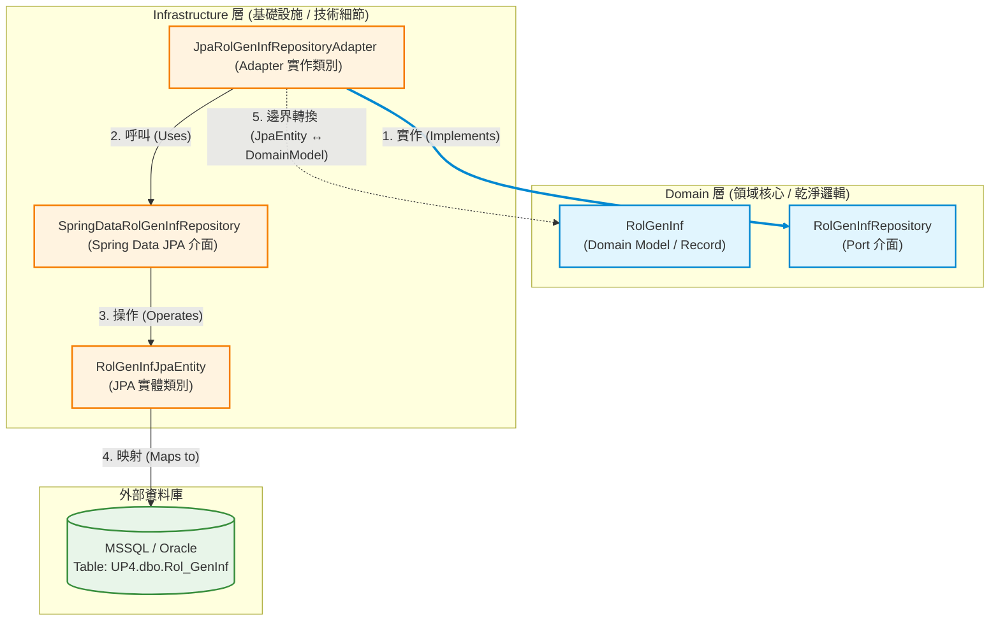

要建一個 JPA 在 common 模組
Clean 架構，
Port 介面，如 repository 是在 domain.port.repository 下.
我看我可能要回去看一下自己的文件。

>[!success] Domain 層 (領域物件與 port 介面), Domain 不關心資料從哪裡來，只管處理資料。
>- 領域物件
>domain.model.RolGenInf 目前是採 Record 方式。
>- port 介面 
>domain.port.repository.RolGenInfRepository
>


>[!success] Infrastructure 層 (Jpa Entity, Spring Data, Adapter) 就是**底層硬體與外接設備驅動程式**（例如螢幕、藍芽、相機、WiFi，或是連接不同品牌的充電線）。
>- infrastructure.persistence.jpa.entity.RolGenInfJpaEntity
>- infrastructure.persistence.jpa.repository.SpringDataRolGenInfRepository
>- infrastructure.persistence.jpa.repository.JpaRolGenInfRepositoryAdapter
>外部系統的 adapter, 
>domain 會定義規格，也就是 port 介面，如: RolGenInfRepository，但它不會管資料怎麼來的，故，

Infra 層負責提供 Adapter 實作，寫出具體的技術細節。
(一) 外部系統的  Adapter
	(1) 存取資料庫: 執行 SQL 把資料取出。
	(2) 呼叫第三方 api: 串接外部服務
	(3) 發送/接受訊息.
(二) 資料結構轉換器 (data mapping / conversion)


在 **Clean Architecture / Hexagonal Architecture（六角架構）** 裡，**Infrastructure 層（基礎設施層）** 的主要職責就是「處理所有與外部技術細節相關的操作」。


如果把你的系統比喻成一台**智慧手機**：

  

- **Domain 層** 是手機的**作業系統核心與邏輯**（它知道怎麼算數、怎麼處理資料，但不關心資料從哪裡來）。
    
      
    
- **Infrastructure 層** 就是**底層硬體與外接設備驅動程式**（例如螢幕、藍芽、相機、WiFi，或是連接不同品牌的充電線）。
    
      
    

### Infrastructure 層程式主要在做什麼？

#### 1. 外部系統的「適配器 (Adapters)」

Domain 層會定義它需要的規格（也就是 **Port 介面**，例如 `RolGenInfRepository`），但 Domain **完全不在乎也不想知道**資料是存在 MSSQL、Oracle、MongoDB，還是透過 API 拿到的。

  

Infrastructure 層負責提供這個 **Adapter（實作類別）**，寫出具體的技術細節：

  

- **存取資料庫**：用 JDBC、JPA、MyBatis 執行 SQL 語句，將 DB 資料抓出來。
    
      
    
- **呼叫第三方 API**：使用 `RestClient` 或 `WebClient` 去串接外部的金流、郵件服務（SendGrid）、第三方認證等。
    
      
    
- **發送 / 接收訊息**：串接 RabbitMQ、Kafka、Redis 來處理訊息佇列。
    
      
    

#### 2. 資料結構的轉換器 (Data Mapping / Conversion)

資料庫或外部 API 回傳的資料結構，通常帶有強烈的技術色彩（例如 JPA Entity 的 `@Entity`、`@Column`、`@Table` 等註解）。

  

Infrastructure 層負責做**邊界轉換**：

  

- 拿 DB 資料時：`JPA Entity` / `JdbcRecord` ➔ 轉成 ➔ `Domain Model`（丟回給 Domain 層使用）。
    
      
    
- 寫入 DB 時：`Domain Model` ➔ 轉成 ➔ `JPA Entity`（存進 DB）。
    
      
    

這樣做能保證 **Domain 層不會被特定資料庫技術污染**，日後就算把 MSSQL 改成 Oracle，也只需要修改 Infrastructure 層的轉換邏輯與 Entity，Domain 層一行程式碼都不用動。

  

#### 3. 底層技術元件的配置 (Configuration & Framework Support)

所有與 Spring Framework、資料庫連線池（HikariCP）、Security 安全性設定、圖書庫設定相關的 Code，也都屬於 Infrastructure 的範疇：

  

- 設定 DataSource、JPA Properties、Transaction Manager。
    
      
    
- 設定 JWT、OAuth2、XSS Filter（如同你目錄中的 `xss` 工具）。
    
      
    
- 設定快取機制（Redis Cache Manager）。
    
      
    

### 程式碼職責對照表

以你剛才建的 `ROL_GENINF` 為例，各層職責分工如下：

  

|**層級 (Layer)**|**角色**|**程式碼範例**|**主要工作**|
|---|---|---|---|
|**Domain**|**Port (規格)**|`RolGenInfRepository` (Interface)|宣告「我需要根據 ID 找資料」的規格。|
|**Domain**|**Model (核心)**|`RolGenInf` (Record)|純粹的業務資料，不帶任何 DB 註解。|
|**Infrastructure**|**Entity (DB對應)**|`RolGenInfJpaEntity`|對應 MSSQL/Oracle 表格結構與欄位細節。|
|**Infrastructure**|**Adapter (實作)**|`JpaRolGenInfRepositoryAdapter`|實作 Port 介面，使用 JPA 查出 Entity 後**轉成 Domain Model** 回傳。|

簡而言之，Infrastructure 層就是專門處理「所有跟特定框架、特定資料庫、特定工具軟體綁定」的死板技術細節，把乾淨的業務邏輯留給 Domain 層！





### 圖解說明與資料流向

1. **依賴倒置原則 (Dependency Inversion Principle)**：
* 箭頭 **`1`**（`Adapter` 實作 `Port`）是整個架構的核心精髓。
* **Domain 層完全不依賴 Infrastructure 層**，只有 Infrastructure 層單向依賴 Domain 層的 Port 與 Model。


2. **查詢資料時的完整運作流程 (Data Flow)**：
* **步驟 A**：`Domain` 或 `Application` 層呼叫 `RolGenInfRepository`（Port 介面）。
* **步驟 B**：Spring 自動注入並執行 `JpaRolGenInfRepositoryAdapter`（Adapter）。
* **步驟 C**：Adapter 透過 `SpringDataRolGenInfRepository` 使用 JPA 向資料庫查詢 `Rol_GenInf` 表格。
* **步驟 D**：資料庫回傳結果，JPA 封裝成 `RolGenInfJpaEntity`。
* **步驟 E（核心隔離）**：Adapter 內部將含有 `@Entity` / `@Column` 註解的 `RolGenInfJpaEntity` 轉換（Mapping）為乾淨的 `RolGenInf` (Domain Record)。
* **步驟 F**：回傳 `RolGenInf` 給 Domain 層，達成底層技術與業務邏輯的完全解耦。

**會有細微差異，主要集中在資料庫 Schema / Catalog 的配置，以及特定舊型態（如 `ntext` vs `CLOB`）的轉換。**

  

雖然 JPA (Hibernate) 本身具備方言（Dialect）機制，會自動處理不同資料庫的 SQL 語法差異，但在寫 Entity 程式碼時，MSSQL 與 Oracle 在以下幾個重點上有不同的處理方式：

  

### 1. Schema 與 Catalog 設定

MSSQL 的層級通常是 **`Database (Catalog).Schema.Table`**，而 Oracle 通常是 **`Schema (User).Table`**：

  

- **MSSQL**：
    
      
    
    Java
    
    ```
    @Table(name = "Mem_Config", schema = "dbo", catalog = "UP4")
    ```
    
- **Oracle**：
    
      
    
    Java
    
    ```
    @Table(name = "MEM_CONFIG", schema = "UP4") // Oracle 通常不使用 catalog
    ```
    

### 2. 大文字與 LOB 型態 (Text vs CLOB)

- **MSSQL** 的舊文字型態為 `text` / `ntext`：
    
      
    
    Java
    
    ```
    @Lob
    @Column(name = "Config", columnDefinition = "ntext")
    private String config;
    ```
    
- **Oracle** 的大文字型態為 `CLOB` / `NCLOB`：
    
      
    
    Java
    
    ```
    @Lob
    @Column(name = "CONFIG", columnDefinition = "NCLOB")
    private String config;
    ```
    

### 3. 表格與欄位大小寫敏感度 (Case Sensitivity)

- **MSSQL**：通常不區分大小寫（常用 CamelCase 或 PascalCase），例如 `MemID`。
    
      
    
- **Oracle**：預設資料庫內部物件與欄位全是大寫。如果在 JPA 寫小寫或 CamelCase，Hibernate 可能會自動加雙引號轉成大寫查詢；為了避免命名對不上的問題，Oracle 的 Entity 欄位映射建議直接指定大寫名稱：
    
      
    
    Java
    
    ```
    @Column(name = "MEM_ID")
    ```
    

### 4. 自動遞增主鍵機制 (Auto Increment vs Sequence)

如果 DDL 包含自動編號主鍵：

  

- **MSSQL (Identity)**：
    
      
    
    Java
    
    ```
    @Id
    @GeneratedValue(strategy = GenerationType.IDENTITY)
    private Long id;
    ```
    
- **Oracle (Sequence)**（特別是舊版 Oracle 11g 或更早）：
    
      
    
    Java
    
    ```
    @Id
    @GeneratedValue(strategy = GenerationType.SEQUENCE, generator = "seq_gen")
    @SequenceGenerator(name = "seq_gen", sequenceName = "SEQ_MEM_ID", allocationSize = 1)
    private Long id;
    ```
    

### 結論與建議

若你的專案需要**同時相容 MSSQL 與 Oracle**：

  

1. **移除 `@Table` 中的 `catalog` 與 `schema` 屬性**：改由 `application.yml` 的連線字串或預設 Schema 控制，避免寫死。
    
      
    
2. **簡化 `@Column` 註解**：儘量省略 `columnDefinition`（如 `columnDefinition = "ntext"`），交給 Hibernate Dialect 根據當前連線的 DB 自動映射。
    
      
    
3. **字串大容量欄位**：保留 `@Lob` 標註，Hibernate 在 MSSQL 會 mapping 到 `ntext`/`nvarchar(max)`，在 Oracle 會 mapping 到 `CLOB`/`NCLOB`。