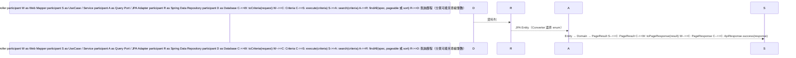

# API 10：取得專案組織成員異動紀錄 — 現行實作與 DDD／Clean 分層  
  
整理日期：2026-11-06。依目前原始碼整理；這是現行實作導覽，不是待實作規格。舊的 get-project-member-change-history-guide.md 為實作教學，路徑與細節應以本文件及原始碼為準。  
  
## 1. API 與核心語意  
  
- `POST /up/api/project/org/employees/history`  
- Controller 方法：`getProjectMemberChangeHistory`  
- 方法授權：`@PreAuthorize("isAuthenticated()")`；僅由這個註解不能推論已做專案成員權限檢查。  
- 資料來源：`UP4_PROJECT_MEM_LOG`，查詢歷史快照，不 JOIN 現在的人員／職務名稱。  
- 回傳所有符合條件的異動紀錄，不是每位成員最新一筆，也不排除目前仍在專案內的人；這與 API 14 的離開成員清單不同。  
  
## 2. 執行流程與依賴方向  
  

  
呼叫會走到 Infrastructure，但原始碼依賴方向仍是外層依賴內層：Web 依賴 Application；Application 定義 Query Port；Infrastructure 實作該介面並依賴 Application／Domain。Service 不需要知道實際執行 SQL 的類別。  
  
UseCase 是提供給 Controller 的輸入介面，Query Port 是用例向外取得資料的介面。Repository Adapter 與 Query Port Adapter 都在 Infrastructure，但前者提供領域物件存取，後者提供用例需要的查詢結果；不是「Repository 只能寫、Query Port 才能讀」。  
  
## 3. 相關檔案索引  
  
以下連結相對於本文件，可直接開啟原始碼。  
  
### Web 入口與輸出  
  
| 檔案 | 用途 |  
|---|---|  
| [ProjectMemberController](../../up/src/main/java/com/flowring/up/adapter/web/controller/projectorg/member/ProjectMemberController.java) | getProjectMemberChangeHistory 接收 POST、觸發 @Valid、呼叫 UseCase，最後以 ApiResponse.success 包裝。 |  
| [ProjectMemberHistoryRequest](../../up/src/main/java/com/flowring/up/adapter/web/dto/request/projectorg/member/ProjectMemberHistoryRequest.java) | HTTP JSON 與 Jakarta Validation 驗證規則。 |  
| [ProjectMemberHistoryMapper](../../up/src/main/java/com/flowring/up/adapter/web/mapper/projectorg/member/ProjectMemberHistoryMapper.java) | Request → Criteria；Domain → Response；日期與活動代碼格式化。 |  
| [ProjectMemberHistoryResponse](../../up/src/main/java/com/flowring/up/adapter/web/dto/response/projectorg/member/ProjectMemberHistoryResponse.java) | 對外單筆歷程格式，不包含 logId。 |  
| [PageResponse](../../up/src/main/java/com/flowring/up/adapter/web/dto/response/PageResponse.java) | 對外分頁格式。 |  
  
### Application 用例與查詢契約  
  
| 檔案 | 用途 |  
|---|---|  
| [GetProjectMemberHistoryUseCase](../../up/src/main/java/com/flowring/up/application/usecase/projectorg/member/GetProjectMemberHistoryUseCase.java) | 輸入邊界：execute(Criteria)，回傳 PageResult<UP4ProjectMemLog>。 |  
| [GetProjectMemberHistoryService](../../up/src/main/java/com/flowring/up/application/service/projectorg/member/GetProjectMemberHistoryService.java) | 實作用例，以唯讀交易呼叫 Query Port.search；不直接使用 JPA。 |  
| [ProjectMemberHistoryCriteria](../../up/src/main/java/com/flowring/up/application/query/projectorg/member/ProjectMemberHistoryCriteria.java) | 內部查詢條件，活動已轉 enum，排序方向為 boolean；unpaged 只看 pageSize == -1。 |  
| [ProjectMemberHistoryQueryPort](../../up/src/main/java/com/flowring/up/application/query/projectorg/member/ProjectMemberHistoryQueryPort.java) | 輸出邊界：由 Application 定義需要的查詢能力；API 10 使用 search，另兩個方法供 API 11、14 使用。 |  
| [PageResult](../../up/src/main/java/com/flowring/up/application/result/PageResult.java) | 內部泛型分頁結果，隔離 Spring Page；map 轉換內容並保留分頁資訊。 |  
  
### Domain 歷史資料模型  
  
| 檔案 | 用途 |  
|---|---|  
| [UP4ProjectMemLog](../../up/src/main/java/com/flowring/up/domain/model/entity/projectorg/member/UP4ProjectMemLog.java) | 歷程資料的領域表示，含異動當時的人員、職務與組織資訊，不帶 JPA 註解。updateRoleInfo 不是此讀取 API 的執行步驟。 |  
| [ProjectMemberActivity](../../up/src/main/java/com/flowring/up/domain/model/enums/projectorg/member/ProjectMemberActivity.java) | JOIN / LEAVE 與 join / leave 代碼的領域定義。 |  
  
### Infrastructure 資料庫實作  
  
| 檔案 | 用途 |  
|---|---|  
| [JpaProjectMemberHistoryQueryPortAdapter](../../up/src/main/java/com/flowring/up/infrastructure/persistence/jpa/repository/projectorg/member/JpaProjectMemberHistoryQueryPortAdapter.java) | 實作 Query Port；toSpec 建條件、search 處理排序分頁，Entity 轉 Domain 後回傳。 |  
| [SpringDataUP4ProjectMemLogRepository](../../up/src/main/java/com/flowring/up/infrastructure/persistence/jpa/repository/projectorg/member/SpringDataUP4ProjectMemLogRepository.java) | 繼承 JpaRepository、JpaSpecificationExecutor；API 10 使用繼承的 findAll(spec, pageable/sort)。檔案中的離開成員 native SQL 並不是 API 10 使用的查詢。 |  
| [UP4ProjectMemLogJpaEntity](../../up/src/main/java/com/flowring/up/infrastructure/persistence/jpa/entity/projectorg/member/UP4ProjectMemLogJpaEntity.java) | 映射 UP4_PROJECT_MEM_LOG；LOG_ID 為單一主鍵，@PrefixedId 使用 SEQ_UP4_PROJECT_MEM_LOG。 |  
| [UP4ProjectMemLogMapper](../../up/src/main/java/com/flowring/up/infrastructure/persistence/jpa/mapper/projectorg/member/UP4ProjectMemLogMapper.java) | MapStruct 產生 JPA Entity ↔ Domain 轉換；此 API 使用 toDomain。 |  
| [ProjectMemberActivityConverter](../../up/src/main/java/com/flowring/up/infrastructure/persistence/jpa/converter/projectorg/member/ProjectMemberActivityConverter.java) | Hibernate 自動套用 AttributeConverter，資料庫 join/leave ↔ 領域 enum；與 Web mapper 不同。 |  
  
### 歷程寫入來源（不是 API 10 的直接呼叫鏈）  
  
| 檔案 | 用途 |  
|---|---|  
| [UpdateAFProjectTreeService](../../up/src/main/java/com/flowring/up/application/service/projectorg/tree/UpdateAFProjectTreeService.java) | AF 組織樹成員異動時建立歷程。 |  
| [UpdatePartnerProjectTreeService](../../up/src/main/java/com/flowring/up/application/service/projectorg/tree/UpdatePartnerProjectTreeService.java) | 企業夥伴組織樹成員異動時建立歷程。 |  
| [UP4ProjectMemLogRepository](../../up/src/main/java/com/flowring/up/domain/repository/projectorg/member/UP4ProjectMemLogRepository.java) | 領域歷程存取契約，包含 save、delete 與依專案／成員／版本查詢。 |  
| [JpaUP4ProjectMemLogRepositoryAdapter](../../up/src/main/java/com/flowring/up/infrastructure/persistence/jpa/repository/projectorg/member/JpaUP4ProjectMemLogRepositoryAdapter.java) | 實作 Domain repository，透過 mapper 與 Spring Data 保存／刪除歷程。與查詢用 QueryPortAdapter 職責不同。 |  
  
共用回應由 [ApiResponse](../../common/src/main/java/com/flowring/common/response/ApiResponse.java) 提供：成功時 code=200、msg=success、data 為 PageResponse。框架層的驗證例外處理可參考 [RRExceptionHandler](../../common/src/main/java/com/flowring/common/infrastructure/web/RRExceptionHandler.java)；本文件不宣稱所有錯誤都已驗證其 HTTP 狀態。  
  
## 4. Request 與實際篩選規則  
  
```json  
{  
  "pageSize": 10,  "page": 1,  "projectId": "PRJ001",  "keyword": "",  "orgId": "",  "isPartner": false,  "activity": ["join", "leave"],  "rolName": null,  "order": "descend",  "sort": "updatedAt"}  
```  
  
| 欄位 | 現行處理 |  
|---|---|  
| projectId | 不可空白；比對歷程 projectId 相等。 |  
| keyword | 不可 null；空白不篩選，有值對 memName 做小寫 LIKE `%keyword%`。 |  
| orgId | 不可 null；空白不篩選。有值以 orgPathId LIKE `%-orgId` 比對尾段，並跳脫 !、%、_。 |  
| isPartner | Request 要求非 null；false/true 分別篩選。Adapter 雖支援 null 不篩選，但正常通過驗證的 HTTP Request 無法傳 null。 |  
| activity | 非 null 且非空清單，字串限定 join/leave；Mapper 轉 enum，Adapter 使用 IN。元素沒有 @NotNull，需注意 null 元素仍可能在轉換時失敗。 |  
| rolName | null 忽略職務條件；非 null 使用 IN，空清單表示不選任何職務，並非忽略篩選。 |  
| page | 必填；Mapper 將除 -1 外的小於 1 數字修正為 1。 |  
| pageSize | 必填；-1 全取，其餘傳入 PageRequest，目前沒有正數範圍驗證。 |  
| order | ascend / descend，轉為 ascending boolean。 |  
| sort | 必填非空，但未放入 Criteria，實際固定以 updatedAt、logId 排序。 |  
  
Adapter 的所有有效條件以 AND 組合。orgId 現況不是任意節點的遞迴子樹查詢；例如路徑 ROL-DEP-COMPANY，只會以 COMPANY 尾段匹配，不能將它當成已支援部門／職務子層查詢。  
  
## 5. 分頁與排序  
  
正常分頁使用 `PageRequest.of(page - 1, pageSize, sort)`，將前端一基頁碼轉為 Spring 零基頁碼。Spring Page 的 totalElements、totalPages 被包裝成 PageResult，避免將 Spring Page 暴露到 Application 契約。  
  
`pageSize = -1` 時使用 `findAll(spec, sort)`，回傳 page=1、pageSize=-1、total=清單大小、totalPage=非空時 1／空時 0。全取會載入全部符合資料，資料量大時須留意記憶體與回應大小。  
  
排序以 updatedAt 為主、logId 為次，兩者同為升冪或降冪。次排序可固定同時間紀錄的順序，但不能保證資料在跨頁查詢期間被新增／刪除時仍無重複或漏項。  
  
`page = -1` 本身不代表全取；若 pageSize 仍為正數，Mapper 保留 -1 後會形成負的 PageRequest 索引，導致例外。  
  
## 6. Response 與欄位來源  
  
```json  
{  
  "code": 200,  "msg": "success",  "data": {    "page": 1,    "pageSize": 10,    "total": 1,    "totalPage": 1,    "list": [{      "projectId": "PRJ001",      "version": "V001",      "memId": "MEM001",      "memName": "王小明",  
      "avatar": "",      "rolId": "ROL001",      "rolName": "工程師",  
      "orgPathId": "ROL001-DEP001-COMPANY001",      "orgPathName": "工程師-研發部-公司",  
      "updatedAt": "2026-11-06 09:00",      "isPartner": false,      "activity": "join"    }]  }}  
```  
  
以上為格式示例，不代表實際資料。projectId、version、memId、memName、avatar、rolId、rolName、orgPathId、orgPathName、isPartner 均來自歷程快照。logId 用於資料識別與排序，但不在 Response 中。  
  
- updatedAt：資料庫 BIGINT／Domain Long 毫秒時間戳，Web mapper 以 Asia/Taipei 格式化成 yyyy-MM-dd HH:mm；null 保持 null。  
- activity：資料庫字串由 JPA Converter 轉 enum，再由 Web mapper 轉 join/leave。  
- JPA mapper 處理持久化模型與 Domain 模型；Web mapper 處理 HTTP 契約。兩者不可混為一個職責。  
  
## 7. 從 DDD／Clean 理解目前設計  
  
歷程的業務意義是保存當時資訊，因此 Domain log 具有姓名、職務名稱與組織路徑等快照欄位。讀取時不重新 JOIN 當前名稱，可以避免職務改名或刪除使歷史資訊失真。是否完整保存仍取決於寫入流程，這份文件沒有對所有寫入情境做整合驗證。  
  
Request、Response 是外部協定；Criteria、PageResult 是內部用例契約；Domain log 是業務資料表示；JPA Entity 才帶有 @Table、@Column、@Id 等持久化細節。  
  
目前用例回傳 PageResult<UP4ProjectMemLog>，沒有專門的 ProjectMemberHistoryResult。這符合依賴方向：外層可依賴內層，但也讓 Web mapper 與 Domain 欄位耦合。若日後回傳格式或查詢模型獨立演進，可以新增 Application Result，並非現在缺少它就違反 Clean。  
  
Service 使用 Spring @Service、@Transactional，是現有專案的務實分層選擇，不是完全框架無關的純 Application。Domain log 也有 Lombok setter 及 updateRoleInfo，目前不是不可變歷史模型；不能只因放在 domain package 就宣稱已完整封裝所有業務不變條件。  
  
Criteria 集中查詢條件；Specification 是 JPA 動態 SQL 條件組裝，留在 Infrastructure，避免 Application 依賴 JPA API。此 API 讀取歷程，不需要呼叫 Domain 的 save/delete Repository。  
  
## 8. 現行限制與後續維護提醒  
  
1. sort 雖驗證必填但實際忽略；應明確限制 updatedAt 或真的實作允許的排序欄位。  
2. page/pageSize 缺少完整範圍驗證；page=-1 與 pageSize=-1 的語意應統一。  
3. isPartner 的 null 註解與 @NotNull 不一致；以實際驗證為準。  
4. orgId 只比對路徑尾段；若需求是任意節點與子層，需另行設計條件。  
5. keyword 未像 orgId 一樣跳脫 LIKE 的 %、_，它們可能被解讀成萬用字元，而不是純文字。  
6. JpaProjectMemberHistoryQueryPortAdapter 的注入欄位目前為 public final；可改 private final 改善封裝。  
7. UP4ProjectMemLogMapper 的「複合主鍵」註解已不符合目前 Entity；目前主鍵是單一 logId。  
8. API 11 的職務名稱清單、API 14 的最新離開成員查詢共用 Port／Repository，但不是 API 10 的執行步驟。  
  
## 9. 建議驗證案例  
  
- 不同 projectId 的紀錄不可混入；join/leave、isPartner、職務名稱複選正確。  
- rolName=null 與 [] 的差異；keyword/orgId 空白與特殊字元行為。  
- pageSize=-1 的空／非空結果；正常頁碼、非法 page/pageSize。  
- 相同 updatedAt 時 logId 次排序；ascend/descend 都正確。  
- 日期時區、enum 代碼與分頁序列化格式。  
- 更名／刪除現行職務後，既有快照仍可讀取。  
  
本次工作僅整理文件與核對原始碼，未修改業務程式、未執行 API／資料庫整合測試。