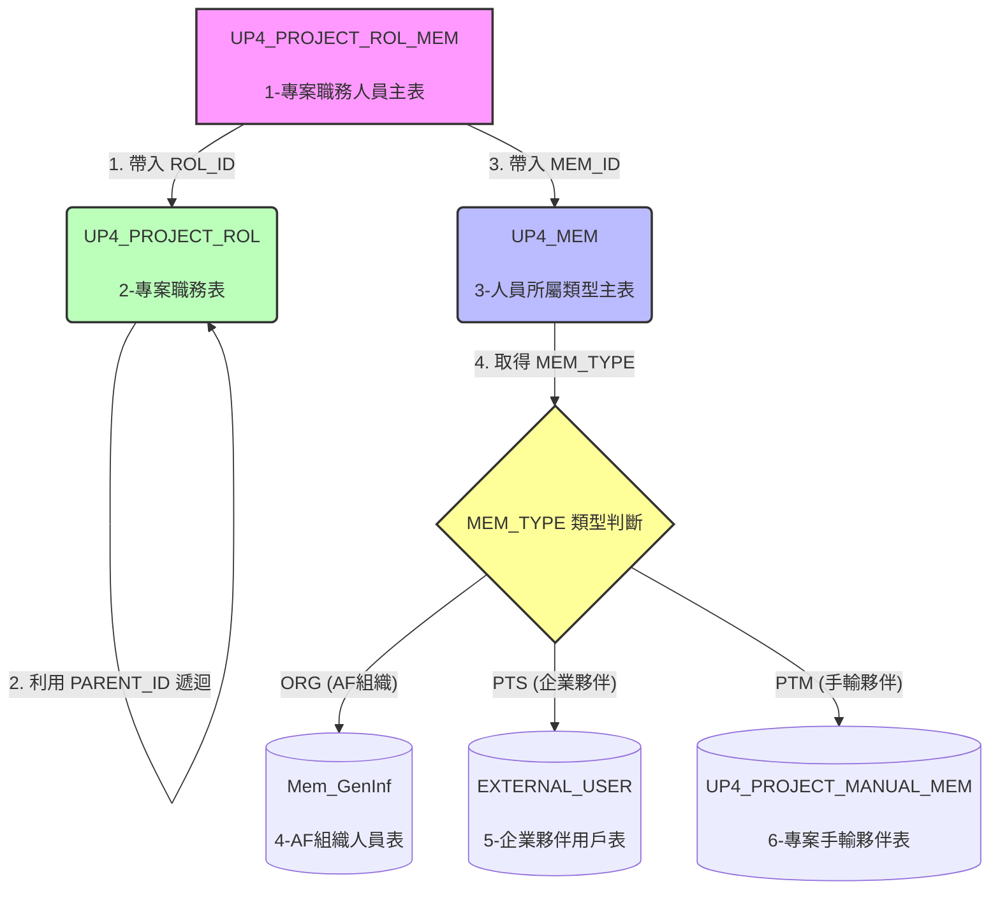

## 分享原由
之前有說過 UP4 會以新的 DDD + clean 架構概念撰寫。
現在 api 已進入實作階段，故挑一個案例介紹實作內容，同時介紹 ArchUnit 驗證依賴方向套件。

## 分享目標

透過 `GET /up/api/project/{projectId}/members`，說明一支既有 API 如何以 DDD 與 Clean Architecture 分離責任，並示範如何用 ArchUnit 與單元測試守住這些邊界。

回顧: 設計概念
http://hedgedoc.flowring.com/_w5nxfUySIWDZZO5AebDMw

---

## ==(一) 為何選這支 API？==

[04 取得專案成員API 文件](http://hedgedoc.flowring.com/RSdJnKzfRE-hLAoDVXlRug?view#04-%E5%8F%96%E5%BE%97%E5%B0%88%E6%A1%88%E6%88%90%E5%93%A1-)
- 規模適中，涵蓋典型設計


- 資料來自多個來源：專案職務關聯、職務名稱、人員類型，以及依類型而不同的姓名與頭像。
- 有明確的分流規則：`ORG`（組織成員）、`PTS`（企業夥伴）、`PTM`（手動輸入夥伴）。
- 有「外部能力」需要隔離：頭像網址由 `AvatarUrlService` 產生。
- 只讀取、不寫入，適合先專注在依賴方向與邊界，不被聚合規則分散注意力。

- 本 API 資料關聯流程圖

---

## ==(二) 請求與依賴方向==

```text
GET /up/api/project/{projectId}/members
   │
   ▼
ProjectMemberController                  adapter.web.controller
   │  只認識 UseCase 介面與 Mapper
   ▼
GetProjectMembersUseCase  (介面)         application.usecase       ← 輸入埠
   ▲  實作
GetProjectMembersService                 application.service
   │  只認識 Port / Repository 介面
   ├──▶ Up4ProjectRolMemRepository       domain.repository         ← 輸出埠
   ├──▶ Up4ProjectRolRepository          domain.repository
   ├──▶ Up4MemRepository                 domain.repository
   ├──▶ Up4ProjectManualMemRepository    domain.repository
   ├──▶ MemGenInfRepository              common.domain.port
   ├──▶ ExternalUserRepository           common.domain.port
   └──▶ MemberAvatarPort                 common.application.port   ← 輸出埠
          ▲  實作（以上介面皆由 infrastructure 實作）
   Jpa*RepositoryAdapter / MemberAvatarAdapter    infrastructure

回傳：ProjectMemberResult ──▶ ProjectMemberMapper ──▶ ProjectMemberResponse
                (application)          (adapter)              (adapter)
```

依賴規則（Robert C. Martin）：**原始碼的依賴只能指向內層**。對照到本專案：

| 層              | 可以依賴               | 不可以依賴                   |
| -------------- | ------------------ | ----------------------- |
| Adapter        | Application、Domain | Infrastructure          |
| Application    | Domain             | Adapter、Infrastructure  |
| Domain         | （只有 JDK）           | 其他三層、Spring、JPA、Jackson |
| Infrastructure | Application、Domain | Adapter                 |

---

## ==(三) Adapter 只處理 HTTP 邊界==

**檔案**：`ProjectMemberController`

```java=
@GetMapping("/{projectId}/members")
@PreAuthorize("isAuthenticated()")
public ApiResponse<List<ProjectMemberResponse>> getProjectMembers(@PathVariable String projectId) {
    List<ProjectMemberResponse> data =
            projectMemberMapper.toResponseList(getProjectMembersUseCase.execute(projectId));
    return ApiResponse.success(data);
}
```

Controller 做的事只有四件：

1. 定義路由與授權。
2. 取出路徑參數。
3. 呼叫 UseCase（**注入的是介面 `GetProjectMembersUseCase`**）。
4. 用 Mapper 轉成 Response，再包成 `ApiResponse`。

它不查詢資料庫、不判斷 `memType`，也不知道頭像網址怎麼產生。

---

## ==(四) UseCase 介面與 Service==

**輸入埠**：`application/usecase/GetProjectMembersUseCase`

```java
public interface GetProjectMembersUseCase {
    List<ProjectMemberResult> execute(String projectId);
}
```

**實作**：`application/service/GetProjectMembersService`

```java
@Service
@RequiredArgsConstructor
public class GetProjectMembersService implements GetProjectMembersUseCase {
    private final Up4ProjectRolMemRepository up4ProjectRolMemRepository;
    private final Up4ProjectRolRepository up4ProjectRolRepository;
    private final Up4MemRepository up4MemRepository;
    private final Up4ProjectManualMemRepository up4ProjectManualMemRepository;
    private final MemGenInfRepository memGenInfRepository;
    private final ExternalUserRepository externalUserRepository;
    private final MemberAvatarPort memberAvatarPort;
    // ...
}
```

重點：

- 介面（輸入埠）與實作分開，使用者介面（Controller）只依賴介面。
- Service 的七個依賴**全是介面**，沒有任何 JPA、Spring Data 或具體 Service。
- 因此單元測試時，七個依賴都能用 Mockito 替代，不需要資料庫，也不需要啟動 Spring。

> 取捨說明：每個 UseCase 都有介面，會多出一些檔案。本專案選擇一致採用，換來 Controller 與實作之間的清楚邊界，也讓 `adapterUsesUseCaseNotService` 這條規則可以自動檢查。

---

## ==(五) Result 與 Response 為何分開==

兩個型別目前欄位完全相同：

| `ProjectMemberResult`（application.result） | `ProjectMemberResponse`（adapter.web.dto.response） |
| --- | --- |
| `memId`、`name`、`avatar`、`memType`、`projectRoles` | `memId`、`name`、`avatar`、`memType`、`projectRoles` |

**為什麼不共用同一個？**

- `Response` 是對前端的契約，會因 JSON 欄位命名、版本相容而改動。
- `Result` 是 UseCase 的輸出，只表達這個使用情境需要的資料。
- 分開後
    - 改 Web 欄位：例: JSON 命名、前端版本要新增欄位
        - 只會動到 Adapter 層（Response 與 Mapper），Application 與 Domain 完全不受影響。
    - 改 UseCase 輸出：例: Result 少了或改了欄位
        - 手寫 Mapper 會立刻編譯失敗；
        - MapStruct 需設定 unmappedTargetPolicy = ERROR 才能得到同樣效果，並搭配 Mapper 單元測試把關。
        
    - 重點是變動被關在 Adapter 層裡，業務邏輯不會因為前端改欄位而被牽連。若沒有分開，改一個 JSON 欄位名可能要動到 Service，Service 的單元測試也得跟著改。
-  <font color="red">如果 UseCase 直接回傳 `Response`，Application 就依賴了 Web 型別，違反依賴規則。</font>

**轉換位置**：`adapter/web/mapper/ProjectMemberMapper`（MapStruct）

```java
@Mapper(componentModel = "spring")
public interface ProjectMemberMapper {
    ProjectMemberResponse toResponse(ProjectMemberResult result);
    List<ProjectMemberResponse> toResponseList(List<ProjectMemberResult> results);
}
```

規則：**轉換器放在「產出型別」所屬的層**。`Result → Response` 產出 Web 型別，所以放 Adapter。

> 代價：這是嚴格分層必然的樣板程式碼。若專案規模小，也有團隊選擇共用；重點是整個專案一致，並讓依賴方向可被檢查。

---

## ==(六) Port 與 Adapter（依賴反轉）==

- ### 1. Domain 的 Repository 介面與 Infrastructure 實作

    **介面**（Domain，只出現領域型別）：

    ```java=
    public interface Up4ProjectRolMemRepository {
        List<Up4ProjectRolMem> findByProjectId(String projectId);
        // ...
    }
    ```

    **實作**（Infrastructure，JPA 與領域物件的轉換只出現在這裡）：

    ```java=
    private Up4ProjectRolMem toDomainEntity(Up4ProjectRolMemJpaEntity entity) {
        Up4ProjectRolMemJpaEntityId id = entity.getId();
        return new Up4ProjectRolMem(id.getProjectId(), id.getRolId(), id.getMemId());
    }
    ```

    規則：JPA Entity 只能出現在 `infrastructure` 內；Port 的方法簽章只能出現領域型別。

- ### 2. 實例：`MemberAvatarPort`

| hh         | 原本                                        | 現在                                                    |
| ---------- | ----------------------------------------- | ----------------------------------------------------- |
| Service 注入 | `AvatarUrlService`（`common.shared` 的具體類別） | `MemberAvatarPort`（介面）                                |
| 實作位置       | 直接依賴                                      | `MemberAvatarAdapter`（`common.infrastructure.avatar`） |
| 測試時        | 需要處理具體 Service 的依賴                        | 一行 `@Mock MemberAvatarPort`                           |
|            |                                           |                                                       |

```java
// 介面：只描述「Service 需要什麼」
public interface MemberAvatarPort {
	String getAvatarUrl(String memberId);
}

// 實作：包住具體的 AvatarUrlService
@Component
@RequiredArgsConstructor
public class MemberAvatarAdapter implements MemberAvatarPort {
	private final AvatarUrlService avatarUrlService;

	@Override
	public String getAvatarUrl(String memberId) {
		return avatarUrlService.getMemAvatarUrl(null, memberId, true);
	}
}
```

    這就是依賴反轉：**介面定義在使用它的一側，實作放在外層**，使用者因此不再被具體實作綁住。

---

## ==(七) 組裝規則==

### 組裝規則

Service 依 `UP4_MEM.memType` 決定姓名與頭像來源：

| memType | 姓名來源 | 頭像來源 |
| --- | --- | --- |
| `PTM`（手輸夥伴） | `Up4ProjectManualMemRepository` | 固定空字串 `""` |
| `PTS`（企業夥伴） | `ExternalUserRepository`（`displayName`） | `ExternalUser.avatar` |
| 其他（含 `ORG`、查不到 memType） | `MemGenInfRepository`（`userName`，空白視為 `null`） | `MemberAvatarPort.getAvatarUrl(memId)` |

### 可優化項目

| 議題 | 說明 | 影響 |
| --- | --- | --- |
| N+1 查詢 | `toProjectMember` 對每位成員各查一次 `UP4_MEM` 與一次姓名來源 | 成員多時查詢次數與人數成正比 |
| Repository 是「一張表一個」 | 目前 `Up4*` 依資料表劃分，尚未依聚合根整理 | 本支 API 只讀取，影響有限；有更多寫入規則時再重整 |
| 結果順序不保證 | 成員清單來自 `groupingBy` 產生的 Map | 前端若依賴順序可能不穩定；測試也不能做順序斷言 |

---

## ==(八) ArchUnit 驗證依賴方向工具==
單元測試驗證`「功能」`；ArchUnit 驗證`「依賴方向」`。
即使 API 回傳正確，若 Controller 開始依賴 Service 實作，也應讓建置失敗。

>因為此專案為混合架構，目前僅對 UP 做依賴方向驗證。
- ### 配置
    

    **檔案**：`up/pom.xml`

    ```xml
    <dependency>
        <groupId>com.tngtech.archunit</groupId>
        <artifactId>archunit-junit5</artifactId>
        <version>1.3.0</version>
        <scope>test</scope>
    </dependency>
    ```

    - 使用 JUnit 5 時，選用 `archunit-junit5` 這個專用模組。
    - `test` scope：不會被包進正式執行檔。
    - `@AnalyzeClasses` 指定要載入哪個套件的類別，並可用 `importOptions` 調整匯入範圍（例如排除測試類別）。
    - 執行方式：`mvn -pl up -am test`，`ArchitectureTest` 會與其他測試一起執行。

- ### `ArchitectureTest` 解說

    **檔案**：`up/src/test/java/com/flowring/up/architecture/ArchitectureTest.java`

    ```java
    @AnalyzeClasses(packages = "com.flowring.up")
    class ArchitectureTest {

        @ArchTest
        static final ArchRule layers = layeredArchitecture()
                .consideringOnlyDependenciesInLayers()
                .layer("Adapter").definedBy("..adapter..")
                .layer("Application").definedBy("..application..")
                .layer("Domain").definedBy("..domain..")
                .layer("Infrastructure").definedBy("..infrastructure..")
                // 其他層不能依賴 Adapter 層
                .whereLayer("Adapter").mayNotBeAccessedByAnyLayer()
                // 只有 Adapter 和 Infrastructure 可以依賴 Application
                .whereLayer("Application").mayOnlyBeAccessedByLayers("Adapter", "Infrastructure")
                // application、infrastructure、adapter 可以依賴 domain
                .whereLayer("Domain").mayOnlyBeAccessedByLayers("Application", "Infrastructure", "Adapter")
                // 其他層都不能依賴 Infrastructure
                .whereLayer("Infrastructure").mayNotBeAccessedByAnyLayer();

        @ArchTest
        // 禁止 Domain 裡的類別，依賴指定的框架套件 (例: domain 不能依賴 jpa)
        static final ArchRule domainHasNoFramework = noClasses()
                .that().resideInAPackage("..domain..")
                .should().dependOnClassesThat().resideInAnyPackage(
                        "org.springframework..", "jakarta.persistence..", "com.fasterxml..");

        @ArchTest
        // 禁止 Adapter 依賴 application.service 套件裡的任何類別
        static final ArchRule adapterUsesUseCaseNotService = noClasses()
                .that().resideInAPackage("..adapter..")
                .should().dependOnClassesThat().resideInAPackage("..application.service..");
    }
    ```

    ### 語法說明

| 語法 | 意思 |
| --- | --- |
| `@AnalyzeClasses(packages = ...)` | 載入 `com.flowring.up` 下的類別供規則檢查。 |
| `@ArchTest static final ArchRule` | 把一條規則登錄成一個 JUnit 測試。 |
| `layer("X").definedBy("..x..")` | 以套件名稱定義一層；`..` 代表任意層級的套件。 |
| `mayNotBeAccessedByAnyLayer()` | 這一層不能被任何層依賴（最外層）。 |
| `mayOnlyBeAccessedByLayers(...)` | 這一層只能被列出的層依賴。 |
| `noClasses().that()...should().dependOnClassesThat()...` | 通用的套件依賴禁令。 |

### 允許方向矩陣

橫列為「依賴者」，直欄為「被依賴者」：
- Adapter 和 Infrastructure 兩欄幾乎都是 ×。 這兩層都在最外圍，沒有人可以依賴它們（Adapter 對 Infrastructure 為 ×，也符合先前說的「入口不直接認得實作」）。
- Domain 那一列只有自己是「—」，其餘全是 ×。 這表示最內層完全不認識任何其他層，這正是它能被單獨測試、也最穩定的原因。
 
| 依賴者 ＼ 被依賴者 | Adapter | Application | Domain | Infrastructure |
| --- | --- | --- | --- | --- |
| Adapter | — | ✅ | ✅ | ❌ |
| Application | ❌ | — | ✅ | ❌ |
| Domain | ❌ | ❌ | — | ❌ |
| Infrastructure | ❌ | ✅ | ✅ | — |

### 三條規則各擋下什麼

| 規則 | 擋下的問題 | 與 `[04]` 的關係 |
| --- | --- | --- |
| `layers` | 層與層之間出現不允許的依賴 | Service 若 import Web 的 Mapper 或 Response，會失敗。 |
| `domainHasNoFramework` | Domain 引入 Spring、JPA、Jackson | `Up4ProjectRol` 等領域物件保持純 Java。 |
| `adapterUsesUseCaseNotService` | Controller 繞過介面，直接依賴 Service 實作 | Controller 必須注入 `GetProjectMembersUseCase`。 |

### `consideringOnlyDependenciesInLayers()` 的意義

它表示分層規則**只檢查這四層彼此的依賴**，Spring、JDK、`common` 等不屬於任何一層的類別會被忽略，所以才需要第二、三條規則補強。
### 錯誤示範
- **目標**：測試因依賴方向錯誤而失敗。
- **案例**: 在 application 的 service 加入屬於 adapter 層的 mapper
- **預計違反規則**: 其他層不能依賴 Adapter 層 (where layer 'Adapter' may not be accessed by any layer)
- **步驟**：

	1. 先執行一次 `ArchitectureTest`，確認目前是符合依賴方向。
	2. 在 `GetProjectMembersService` 加入一個欄位：
	```java=
	import com.flowring.up.adapter.web.mapper.ProjectMemberMapper;

	private final ProjectMemberMapper projectMemberMapper;   // Application 依賴 Adapter
	```
	1. 重新執行，`layers` 規則失敗，輸出會指出違規的類別與依賴對象。
	2. 還原後再次執行，回到綠燈。

- **注意**:
	**只加 import、沒有實際使用，ArchUnit 不會失敗**。ArchUnit 分析的是編譯後的類別，未使用的 import 編譯後不存在，所以必須讓型別「真的被用到」（欄位、參數或方法呼叫）。專案過去就有這類殘留的未使用 import，這也是很好的說明案例。

---
## ==(九) 其他補充==
- ### 問題 
   若在 @Query 內撰寫完整類別路徑（Fully Qualified Name），進行重構（Refactor，如重新命名或移動套件）時，IDE 高機率無法自動識別並同步更新該字串內容。
- ### 解決方式
    使用介面投影（Spring Data Projections）
    Spring Data JPA 支援直接用 Interface（介面） 來接查詢結果，不需要在 JPQL 裡面寫 new com.xxx... 宣告實體。
- ### 好處
    - 不需要寫 new com...。
    - 如果介面被搬移或改名，IDE 的 Refactor 會自動連動修改，絕對不會漏掉！

- ### 修改實例
    SpringDataUp4MemRepository 裡有 @Query 使用完整類別路徑撰寫。 
    後來因為專案結構調整，把 RoleMemberRow 改到 Result 裡 (命名未變更)，IDE 介面在 refactor 時， 
    並不會一併去修改這種字串，造成啟動時有錯誤。
    [](http://hedgedoc.flowring.com/uploads/87a8979c-da58-4c15-8337-0a9b17a6a3ec.png "點開放大")

    - (1) 建一個 interface 投射用
    [](http://hedgedoc.flowring.com/uploads/ef632342-fd82-48da-b16f-a7390ba54509.png "點開放大")

    - (2) 修改 repository 裡的Query內容
    [](http://hedgedoc.flowring.com/uploads/1d7a315f-f262-4661-93aa-0a4bbe5431a8.png "點開放大")

    - (3) 在實作裡做轉換，把 Projection 轉為原本使用的 RoleMemberRow
    [](http://hedgedoc.flowring.com/uploads/1b6c3a99-0118-408f-9ada-055235add82b.png "點開放大")
    
---

## ==(十) 結語==

這支 API 的重點不是類別數量，而是每個變動都有清楚的對應位置：

| 變動 | 對應位置 |
| --- | --- |
| 路由、授權、JSON 欄位 | `adapter.web`（Controller、Response、Mapper） |
| 使用情境流程、`memType` 分流規則 | `application.service` |
| UseCase 的輸出內容 | `application.result` |
| 頭像網址產生方式、資料庫技術 | `infrastructure`（實作 Port） |
| 依賴方向是否被破壞 | `ArchitectureTest` 擋下 |

重點：
1. **依賴方向是規則，不是口號**。Result 與 Response 分開、Port 放在使用它的一側，是讓規則可執行的兩個動作。
2. **規則寫進 `ArchitectureTest`，就可以靠規則機制，檢驗依賴方向。**。

---

## 參考來源

- Robert C. Martin，〈The Clean Architecture Dependency Rule〉：https://www.informit.com/articles/article.aspx?p=2832399
- ArchUnit 使用案例（套件依賴檢查與分層檢查範例）：https://archunit.org/use-cases
- ArchUnit 入門與設置（Baeldung）：https://www.baeldung.com/java-archunit-intro
- `@AnalyzeClasses` 與 `importOptions`（Scott Logic）：https://blog.scottlogic.com/2019/12/05/unit-test-your-architecture-with-archunit.html
- 專案內既有文件：`docs/architecture/get-project-org-tree-ddd-clean-20min-sharing.md`（格式與 ArchUnit 段落對照）